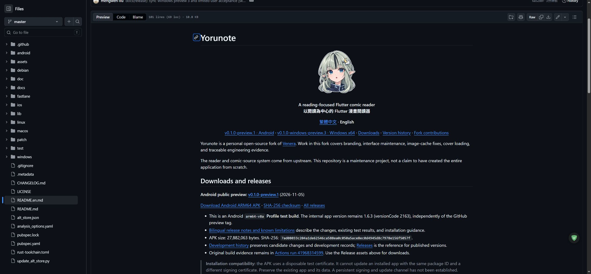

# Windows .3 文件與驗收同步 / Documentation and acceptance sync

- master：[`6a52d8f273a416acd1888be7c7f2a814245f5572`](https://github.com/mengwen-liu/yorunote/commit/6a52d8f273a416acd1888be7c7f2a814245f5572)，由 `f551750db68617a0be2d66f116e263d73af52fe7` 非強制快轉。
- 差異只有 README.md、README.en.md、CHANGELOG.md 及新增的 docs/releases/v0.1.0-windows-preview.3.md；不含 App、workflow、依賴或 LICENSE 修改。四份遠端內容逐一回讀相符，36 個相對連結目標已檢查。
- 瀏覽器實際檢視中英文首頁，確認精靈圖片載入（512×512 原圖），版本入口、ZIP、校驗檔與發行說明都指向公開的 `v0.1.0-windows-preview.3`。本目錄截圖只含公開 GitHub 頁面，沒有使用者私人漫畫畫面。
- 公開下載、Tag 與產品雜湊證據見 [PUBLIC_RELEASE_3.md](PUBLIC_RELEASE_3.md)；使用者兩項 UI 回報見 [OWNER_ACCEPTANCE.md](OWNER_ACCEPTANCE.md)，不擴大為全 App 驗收。
- Notion 專案現況及一筆維護日誌已同步並回讀，紀錄分類為 Mixed／已記錄；舊專案內容保留為歷史且逐字相符。
- 文件同步後 Actions 總數仍為 39；本次只有附件上傳與公開下載核對兩個新 run，沒有另行建置產品或重跑完整測試。Build ALL 已恢復 active，Build ALL／AltStore 無新增執行。
- App 程式仍固定在 Tag 的 `07406c9f`，未合併至 master；Windows 仍為未經 Authenticode 簽章的預覽版。

## 首頁實際版面 / Rendered pages

This sync updates release documentation and records the user's two confirmed UI behaviors. It does not merge application code into master or establish complete device acceptance.
