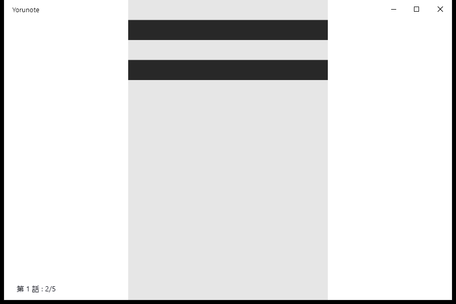
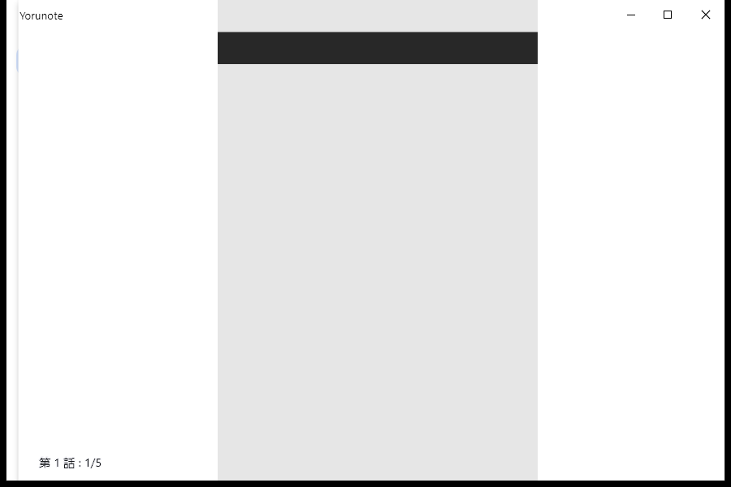

# Windows 預覽版進度快照（歷史工作紀錄）

記錄時間：2026-11-06 02:45（Asia/Taipei）。本檔是當時的進度快照，不是完整驗收通過或公開發行聲明。

- Windows 分支：`codex/yorunote-windows-preview-20261106`。
- 正在驗證的固定來源：`944162b55ba424f13104ba402aa5682d648a9fdb`。
- 目前執行：[CI 42086650235](https://github.com/mengwen-liu/yorunote/actions/runs/42086650235)，工作流程提交 `c0bdb3be0adc9a436d33fc06f248b3d77c733744`。
- 已完成的前一輪：[CI 42081999129](https://github.com/mengwen-liu/yorunote/actions/runs/42081999129)，來源 `76142bf37c055ddc996656f4f49b31b9c2f646a8`，整體結論 failure。

## 前一輪已取得的實際證據

1. Windows Release 編譯、ZIP／AMD64 PE／圖示與資產檢查，以及解壓產物啟動、回應與正常關閉通過。
2. 第一個驗收行程的 9 項檢查通過：獨立 Yorunote 資料位置、繁中標題、HTTP 與 QuickJS、onResponse 圖片解碼、線上閱讀、Windows 原生方向鍵翻頁與 SQLite 第 2 頁、5 頁下載及位元組雜湊、停止伺服器後離線閱讀、英文深色設定保存。
3. 新行程已恢復設定、來源、SQLite 歷史第 2 頁及 5 張下載檔；再次離線閱讀沒有顯示圖片，45 秒後逾時，整體驗收失敗。
4. 失敗時沒有上傳可交付的 ZIP，沒有建立 Windows Tag 或 Release。
5. [原始診斷 artifact](https://github.com/mengwen-liu/yorunote/actions/runs/42081999129/artifacts/13442369189) 的 ZIP digest 為 `849c58edb8e1862075250b4ddc36f4555a746db85432fd09686554578cde1035`；另一次唯讀 CI 下載後重算相符，並讀取其中 JSON 與下列畫面。

以上是合成圖樣，沒有使用私人漫畫內容；只能支持該來源提交、該次 CI 的指定檢查，不代表重新啟動驗收或使用者電腦驗收完成。

## 已修正與目前處理中

- 實際閱讀測試揭露新設定未指定 `followUpdatesFolder` 時，`markAsRead` 將 null 傳給需字串的 `existsFolder`。已加入空值／型別防護及回歸測試。
- 同一份回歸測試在修正前提交 `5d95b24884ee6e07e4fee571a96c7b0534b73c1f` 失敗、修正後通過；連同 4 項既有品牌測試，前輪 Windows CI 共 5 項通過。
- 先前直接呼叫 HardwareKeyboard 並未完整經過 Flutter 焦點事件分派，已改為確認 CI App 擁有前景視窗後，以 Windows SendInput 送出原生方向鍵。
- 目前調整驗收工具：讓全部操作使用 App 的 IO 覆寫環境，等待實際 SQLite 寫入，重新啟動後逐張核對下載檔，並增加失敗時 widget／畫面診斷。尚不能將這些調整寫成完整驗收通過。

## 範圍與限制

- 名稱、Windows ICO、獨立 x64 ZIP 封裝與雙語 Windows 說明已保存於分支。
- App 起點為已公開 Android 預覽版的 `29b590b457378c16b19821f139b9bcad7d38f689`；Windows 流程不呼叫舊安裝器或 Build ALL。
- 本輪尚未修改 master、公開的 Android Release、既有 Tag、Secrets 或 Notion。
- 本機命令執行器受環境路徑／sandbox 啟動問題阻擋；未在使用者電腦安裝工具鏈或執行 App。
- 後續瀏覽器連線因缺少來源瀏覽器內容而無法使用；公開 Release 的操作能力須另行恢復，不能把分支文件當作已建立 Release。
